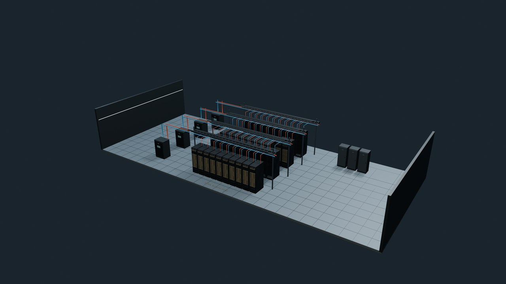

# Rubin长视频素材总览与台本策划入口

更新：2026-10-10T06:20:43+08:00（Asia/Singapore）。此目录用于依据现有素材规划五篇Rubin科普内容。

现有67项自建模型，其中33项原理模型；779张原生4K静图；57组镜头、114条纯画面/标注两版4K30fps静默影片；78个独立讲解点。57组源镜头合计642秒，两版完整软件解码共38,520帧通过。

网页版GPT先读 [GPT_HANDOFF.md](https://raw.githubusercontent.com/migodam/rubin-video-asset-catalog/main/GPT_HANDOFF.md)，再按需读 [镜头目录](https://raw.githubusercontent.com/migodam/rubin-video-asset-catalog/main/SHOTS.md)、[78个讲解点](https://raw.githubusercontent.com/migodam/rubin-video-asset-catalog/main/EXPLANATIONS.md)、[67个模型](https://raw.githubusercontent.com/migodam/rubin-video-asset-catalog/main/ASSETS.md) 和 [完整机器可读目录](https://raw.githubusercontent.com/migodam/rubin-video-asset-catalog/main/data/catalog.json)。

公开入口提供轻量预览与目录。原始Blender、GLB、4K静图与电影位于约10.8GB的本地完整交付包；以下相对素材路径用于识别现有素材，不代表公开下载地址。

## 五篇主题覆盖

| 主题 | 主归属讲解点 | 现有模型和讲解范围 |
| --- | ---: | --- |
| Vera Rubin NVL72 | 29 | 机柜/tray/芯片/内存/互联/控制/供电散热及产业机制 |
| Vera CPU Rack | 14 | 8CPUtray/Olympus/SCF/SOCAMM2/Ethernet/安全隔离及CPU机制 |
| Groq 3 LPX | 16 | SRAM/MXM/VXM/SXM/静态排时/C2C/推理分工/PEP-CPS及比较 |
| BlueField-4 STX / CMX | 9 | KV/存储处理/NAND/FTL/内存tier/迁移/安全及CXL对比 |
| Spectrum-6 SPX / CPO | 10 | packet pipeline/SerDes/CPO/微环/laser/RX/3Dpackage/多plane |

同一模型和镜头可在多篇中复用；跨篇关联数量不可相加。

## 五款tray细化更新

[NVLink、LPX、MGX Ethernet、SN6800与SN6810的新旧对照](TRAY_REFINEMENT.md)。对应开盖主图、板级近景与相关镜头已替换。LPX机架、机房与C2C讲解同步采用官方2U/16LPU配置。原10.8GB完整包保留，最新模型与影片由本地细化补丁包提供。

## 素材层级

| 层级 | 数量 | 可以用于什么画面 |
| --- | ---: | --- |
| 机房与跨尺度总装 | 2 | 机房巡游与机房到die连续转场 |
| 五类机架 | 5 | 五机架外观、内部装配、维护及后部互联 |
| 计算、存储与交换模块 | 8 | 8种模块的开盖、抽拉、冷板、边框、供电和接口 |
| 芯片与封装 | 8 | 七芯片家族及BlueField两版的封装、裸片逻辑分区 |
| HBM4、SOCAMM2与CPO光引擎 | 3 | HBM堆叠、SOCAMM2压接、CPO供光与收发转换 |
| PCB板卡 | 8 | 真实应用角色组织的载板、内存、管理和接口区域 |
| 放大结构与工作原理 | 33 | TSV、存储单元、CPU/LPU、网络、光学、液冷与供电原理 |

## 按讲解问题选素材

| 讲解问题 | 画面顺序与重点 | 镜头编号 |
| --- | --- | --- |
| TSV 与微凸点 | 先沿铜柱穿过硅厚度，再通过层间微凸点进入下一片；横向扇出把HBM底片连向GPU PHY。 | 28 |
| SRAM 6T 与 DRAM 1T1C | 先看保持数据的单元，再看阵列共享外围。6T交叉耦合与两访问管，1T1C电荷分享、恢复、漏电与刷新分阶段解释。 | 25/26/27 |
| System-Level Cache 与 NAND SLC | 前者是系统缓存层级，后者是NAND每cell一bit的编码方式；用不同模型和标题明确分开。 | 29/36/31 |
| 局部缓存、bank 与聚合SRAM | 先区分命中/缺失，再看同bank同slot冲突与错开安排；八片容量求和不等于任何单core本地容量。 | 29/37/38 |
| 3D NAND 电荷与阈值 | 用垂直沟道、介质层与电荷位置解释存储，再对照SLC/TLC/QLC的阈值状态和读出裕量。 | 30/31 |
| SSD 控制器、FTL、GC 与纠错 | 将DRAM/CTRL/NAND实体角色分开，然后追逻辑页映射、有效页搬移、块擦除、擦除计数与纠错/重试/失败；CPU原语不冒称DPU同一执行域。 | 32/42 |
| CPU 内部与缓存一致性 | 由取指、解码、重命名到执行/退休，再接SCF缓存/内存/C2C角色；预测必须有验证或恢复边界。 | 15/35/36/52 |
| CPU I/O PHY、PCIe 与CXL | 先分开计算核心与I/O功能区域；同16条lane的不同分组是替代配置，再用SerDes与CXL路径解释接口。 | 15/35/45/46/51 |
| CPO完整光电路径 | 沿ELS供CW光→EIC电驱动→PIC调制→数据光发出；接收端是光→PD电流→TIA电压→ASIC，不把光传输画成光学逻辑计算。 | 23/47/49 |
| 外置ELS与集成laser | 用两条架构对照解释激光位置、供光与数据光、耦合损耗；Intel原型上下文不能变成NVIDIA量产内部声明。 | 48 |
| PIC、微环与封装界面 | 先看bus waveguide与ring耦合，再分电驱动数据调制和heater热调谐；垂直电bond与光耦合是不同界面。 | 47/49 |
| SerDes、PAM4、均衡与CDR | 从串行差分通道的两/四电平开始，经通道损伤与均衡、采样时钟恢复，再进入PCS/FEC；波形为示意。 | 45/46 |
| RDMA注册与控制/数据域 | 先登记受控内存与权限，再追NIC到GPU的搬运；注销后的旧访问应拒绝，CPU设置与独立管理域仍存在。 | 42/35 |
| KV张量、分层迁移与软件角色 | 先认识K/V张量，再追授权、预取与存储层；Dynamo决策、NIXL搬运、DOCA Memos存储服务分开。 | 33/39/51 |
| LPU静态安排与供电协调 | MEM/MXM/VXM/SXM分角色，安排计算与数据到达；相近频率不等于零相位差，PEP与CPS分别用详细流程解释。 | 37/38/57 |
| 矩阵数据流、NVFP4与Roofline | 沿操作数、复用与累加，再解释分块缩放和算术强度；wafer/torus是通用对照，不是Rubin/Groq厂商floorplan。 | 34/53/54 |
| 热流、液冷接头与VRM/PDN | 热量经材料到冷板与流体；供液/回液、阀开合与电源导体分开。55正式近俯视未独立分辨TIM纵向接触；VRM/decap/多相汇流为示意。56电感点有局部遮挡；57波形是固定归一化对照。 | 55/56/57 |

## 现有素材的使用限制

- 全部预览是自建模型或示意图；verified micrograph为0，不宣称厂商真实物理floorplan或制造级CAD。
- 机房40柜配比与建筑管线是展示布局：16 NVL72、12 LPX、8 SPX、2 Vera、2 STX。
- 6T/1T1C、TSV、光学、VRM与接头等为放大示意；不能按图估计真实制程尺寸、单元面积或器件性能。
- System-Level Cache与NAND Single-Level Cell是不同概念；原理文件分别建模。
- CPO发射端为ELS连续供光→EIC驱动→PIC调制；接收端为PD光电流→TIA电压→后续电处理。
- 集成III-V激光分支用于架构对照，不能改写成NVIDIA量产内部结构声明。
- 缓存、纠错、均衡、微环、负载与波形使用固定教学例子；没有逐周期RTL、电路、电光或瞬态数值仿真。
- Vera片内微字在部分角度低对比；15的标注版页脚另说明核心、SCF/L3、内存PHY和系统I/O。
- 55前段近俯视不能单独辨认chip→TIM→铜底纵向接触；使用功能剖面静图补充。
- 56的线圈会局部遮挡光点；57波形是归一化示例，不能当成量产实测曲线。
- 无独立正式SOCAMM2电影；SOCAMM2可用资产socamm2及07/09板级镜头与压接近景讲解。
- 全部57组源时间轴已实际采样；114片完整软件解码通过。完整连续视觉播放和用户审美批准未获得。
- Groq LPX已按用户要求采用2026-10-10核查的NVIDIA LPX专文与Figure 2：16×2U tray、每tray16LPU、两个FEL+DRAM模块，整柜256LPU。POD总览页仍有32×8的不同数字；旧模型保留为历史版本，当前模型采用专文配置。

## 目录与预览

- [给GPT的完整输入](GPT_HANDOFF.md)
- [镜头阶段与可剪区间](SHOTS.md)
- [模型总表与近景](ASSETS.md)
- [讲解点与依据](EXPLANATIONS.md)
- [按五篇选材](ARTICLES.md)
- [模型预览图册](GALLERY.md)
- [数据目录](data/catalog.json)
- [预览使用说明](PREVIEW_USAGE.md)
