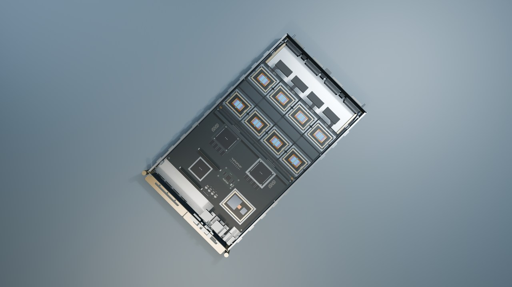
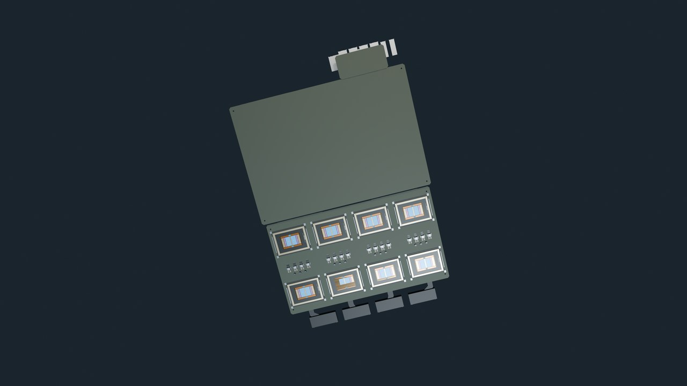

# 五款 tray 细化与 LPX 官网配置更新

2026-10-10。当前交付目录采用这次细化后的几何、静图和相关镜头；原始完整 ZIP 保留为历史基线。

本次更新 NVLink 6 Switch Tray、Groq 3 LPX Tray、MGX Ethernet Tray、Spectrum-6 SN6800、SN6810 及对应五张 PCB。LPX 整柜、机房总装、机房到 die 场景和 C2C 讲解同步更新，共 14 项模型、42 个三档 GLB、9 组镜头的纯画面/标注两版。现有素材总数仍为 67 项自建模型、57 组镜头和 78 个讲解点，原生 4K 静图增加到 779 张。

## 五款的具体变化

| 模块 | 更新后的可见内容 | 适合的讲解 |
| --- | --- | --- |
| NVLink 6 Switch Tray | 四颗交换芯片与周边电路、压紧框、带折边的支撑/配电覆盖层、服务区域、内部供回液和后部铜接口 | NVLink 与前管理接口的分工；交换芯片、PCB、冷板和外壳的装配层次 |
| Groq 3 LPX Tray | 2U 双面基板，上方八颗、下方八颗 LPU；两处 FEL＋DRAM，前左 Host CPU、前右 BlueField-4；双层前接口、背部 C2C 和双面冷板 | SRAM 与两类外接 DRAM 的关系；16 颗 LPU 如何放进一个 tray；C2C 与 Ethernet 的分工 |
| MGX Ethernet Tray | 两排各 16 个 OSFP、主 ASIC、供电/管理邻域、后部铜接口分区、导引和液冷连接 | 可插拔光模块与背板铜连接；端口域、交换 ASIC、管理与供电 |
| Spectrum-6 SN6800 | 5RU 四 ASIC，四套 CPO 光引擎区、对位冷板/压框、开放纤维导向、ELS 服务区域、五供五回液冷接头及四组后电源接触片 | 多 ASIC 的系统层次；供光、收发转换、光纤组织与交换机液冷 |
| Spectrum-6 SN6810 | 2RU 单 ASIC，CPO 光引擎区、双层 ELS 插拔框/导轨、内部供电与纤维导向、两供两回液冷接头及单组后电源接触片 | ELS 独立维护；外置激光、光引擎、数据光纤与电接口 |

新增的器件轮廓、固定件、液路、光纤支架和 PCB 走线帮助解释装配职责。未公开的厂商 BOM、精确器件坐标与内部线路仍标为自建结构示意，不能将细节丰富程度当成实物测量精度。

## LPX 按哪个官方版本

当前采用 [NVIDIA 的 LPX 专文 Figure 2](https://developer.nvidia.com/blog/inside-nvidia-groq-3-lpx-the-low-latency-inference-accelerator-for-the-nvidia-vera-rubin-platform/)：**16 个 2U tray，每 tray 16 颗 LPU，整柜 256 颗**。Figure 2 表示基板上方两行四列八颗，另八颗在底面，中段为两处 FEL＋DRAM，前左为 Host CPU、前右为 BlueField-4。FEL-attached DRAM 与 Host-attached DRAM 分开建模；它们不等于 LPU 的片内 SRAM。

图中两路 Ethernet 和 64 条逻辑 C2C 光链路分别表达，四个可见 C2C 接口组没有被冒充 64 个独立物理插口。该图仍属于 preliminary design。底面八颗的精确 XY、安装间距、完整走线以及 Host/FEL 厂商身份未公开。

[POD 总览](https://developer.nvidia.com/blog/nvidia-vera-rubin-pod-seven-chips-five-rack-scale-systems-one-ai-supercomputer/)仍写 32 tray × 8 LPU。本次按用户“LPU 根据官网来”的要求选用当前 LPX 专文；旧 1U/8-LPU 模型与原完整 ZIP 保留为历史版本。

### LPX 影片的可剪区间

`10-tray-lpx` 为 8 秒、30fps，四段均来自同一帧驱动配方：

| 时间 | 帧范围 | 内容 |
| --- | --- | --- |
| 0–2 秒 | 0–59 | 官网当前的 2U / 16-LPU 配置与 tray 外形 |
| 2–4 秒 | 60–119 | 上方八颗、两 FEL、Host 与 BlueField-4 的区域关系 |
| 4–6 秒 | 120–179 | 隔离实际 PCB，从底面展示另外八颗 LPU |
| 6–8 秒 | 180–239 | 恢复整体装配，说明两路 Ethernet 与 C2C 光链路 |

底面段采用独立下方照明，保留实体封装和周边固定/供电件；它不是显微 die shot。相同状态用于交互站、Blender 影片和 Remotion。

## 新旧自建模型的相同视角对照

以下均为自建几何的缩小预览。使用相同检查方向与视图名；自动构图会随新的几何边界变化。LPX 旧图属于1U/8-LPU历史配置，当前2U/16-LPU依据不同，不能用旧图要求同一外形。

| 模块 | 原PCB | 细化后PCB | 新开盖 | 新后接口 |
| --- | --- | --- | --- | --- |
| NVLink | [旧图](refinement/before/tray-nvlink-pcb-detail.jpg) | [新图](previews/tray-nvlink/pcb-detail.jpg) | [开盖](previews/tray-nvlink/service-detail.jpg) | [后口](previews/tray-nvlink/rear-connector-detail.jpg) |
| LPX | [旧图](refinement/before/tray-lpx-pcb-detail.jpg) | [新图](previews/tray-lpx/pcb-detail.jpg) | [开盖](previews/tray-lpx/service-detail.jpg) | [后口](previews/tray-lpx/rear-connector-detail.jpg) |
| MGX Ethernet | [旧图](refinement/before/tray-etl-pcb-detail.jpg) | [新图](previews/tray-etl/pcb-detail.jpg) | [开盖](previews/tray-etl/service-detail.jpg) | [后口](previews/tray-etl/rear-connector-detail.jpg) |
| SN6800 | [旧图](refinement/before/switch-sn6800-pcb-detail.jpg) | [新图](previews/switch-sn6800/pcb-detail.jpg) | [开盖](previews/switch-sn6800/service-detail.jpg) | [后口](previews/switch-sn6800/rear-connector-detail.jpg) |
| SN6810 | [旧图](refinement/before/switch-sn6810-pcb-detail.jpg) | [新图](previews/switch-sn6810/pcb-detail.jpg) | [开盖](previews/switch-sn6810/service-detail.jpg) | [后口](previews/switch-sn6810/rear-connector-detail.jpg) |

### LPX上侧与下侧

[LPX更新影片的整条时间轴](timelines/10-tray-lpx.jpg)中的4–6秒为底面段。

## 如何取用

当前本地目录的 `index.html`、交互站与 `review/VIDEO_ASSET_GUIDE.json` 指向新素材。原完整包解压后，将 `Rubin-POD-tray-refinement-20261010-owned-patch.zip` 中的 `Rubin-POD/` 内容覆盖到同名目录；未变化的模型和 48 组镜头仍由原完整包提供。补丁附带当前源码、14 项模型、相关静图、18 条 MP4 和完整导航，避免重复下载旧的完整包。

公开资料库提供缩小后的自建预览、镜头阶段和台本规划索引；原始 Blend、GLB、4K PNG 与 MP4 保留在本地。官方参考图片和外部 CAD 不放入自建素材补丁或公开目录。

## 依据与可视范围

NVLink 以 [DGX 硬件说明](https://docs.nvidia.com/dgx/dgxvr-user-guide/hardware.html)为依据，MGX Ethernet 结合 [POD 总览](https://developer.nvidia.com/blog/nvidia-vera-rubin-pod-seven-chips-five-rack-scale-systems-one-ai-supercomputer/)及 [官方交换机产品表](https://www.nvidia.com/en-us/networking/ethernet-switching/)。两款 Spectrum 采用 [SN6000 硬件手册 1.3](https://networking-docs.nvidia.com/sn6000hw/1.3/introduction)、[尺寸表](https://networking-docs.nvidia.com/sn6000hw/1.3/specifications)、[液冷规格](https://networking-docs.nvidia.com/sn6000hw/1.3/liquid-cooling-specifications)与 [ELS 维护说明](https://networking-docs.nvidia.com/sn6000hw/1.3/els-replacement-procedure-for-sn6810-ld-and-sn6800-ld-switch-systems)。手册的 MMC-16 与营销页的 MMC-12 命名差异保留在来源报告，不静默合并。

主 Agent 和专业 Agent 的记录区分真实打开的静图、原生影片抽样、标注样本、格式/解码检查及未验证部分。抽样视觉复核不等于连续全片审美验收。所有 die 视图仍按图像性质标记，核实到的真实显微 micrograph 数量为 0。
